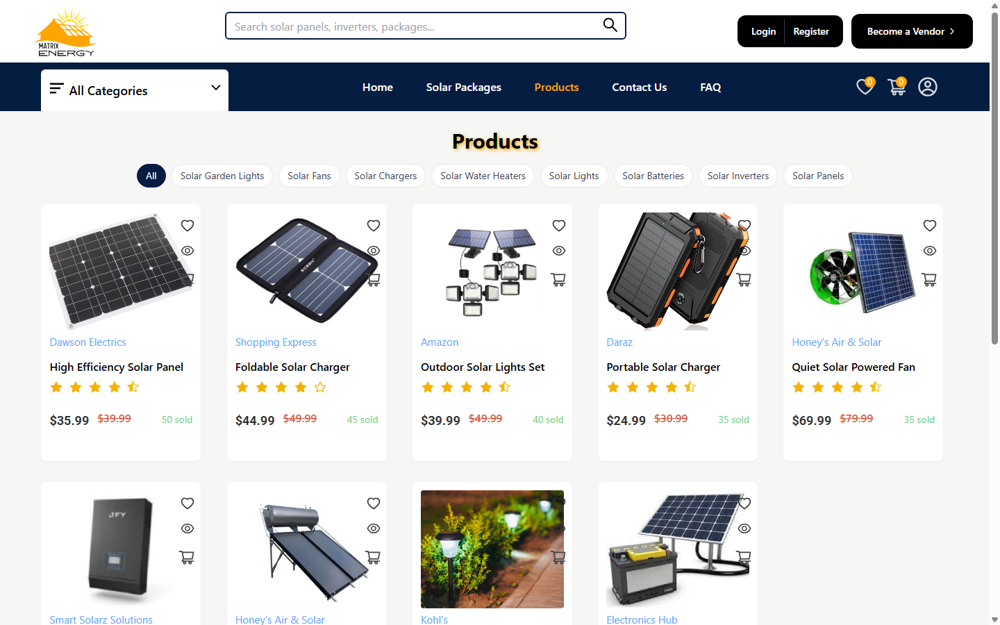
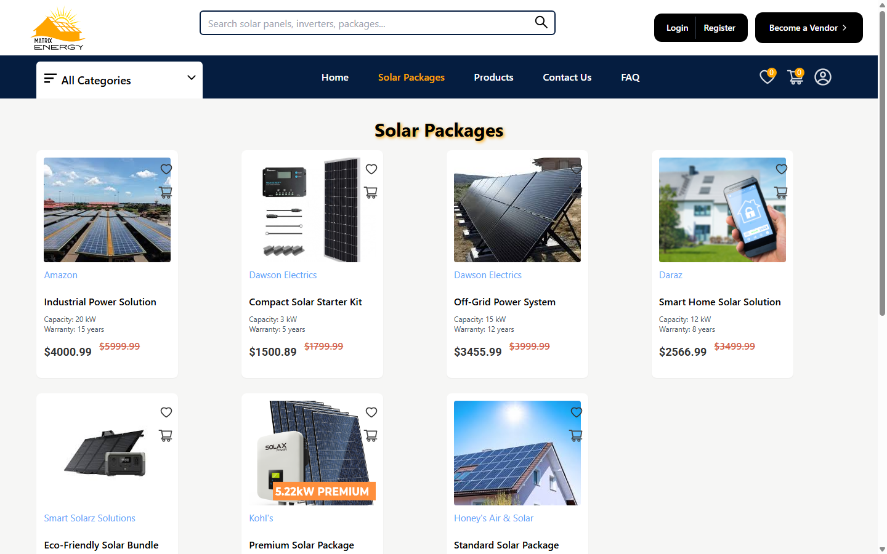
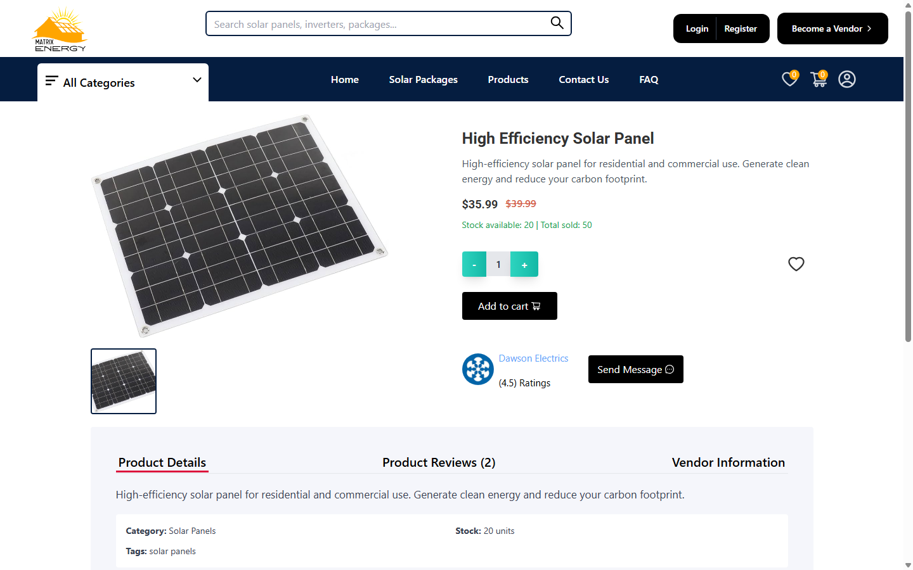
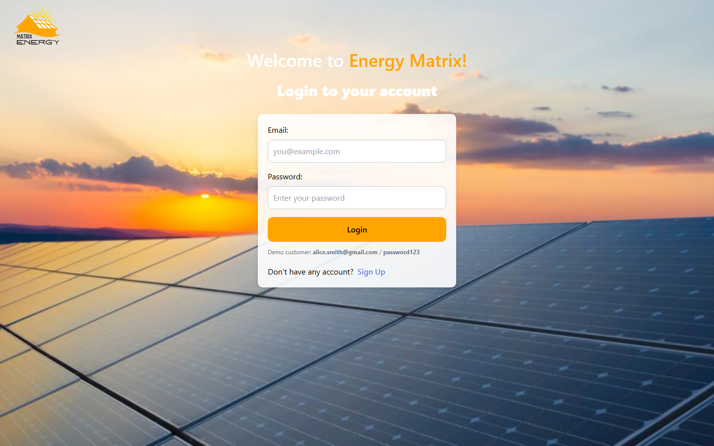
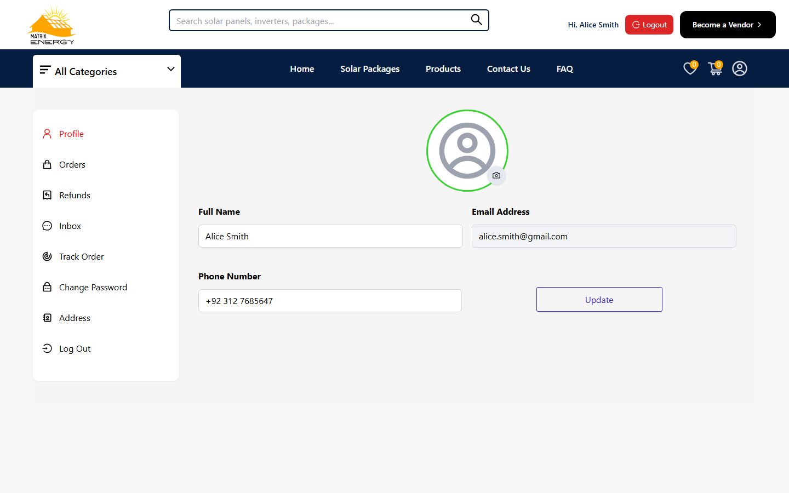
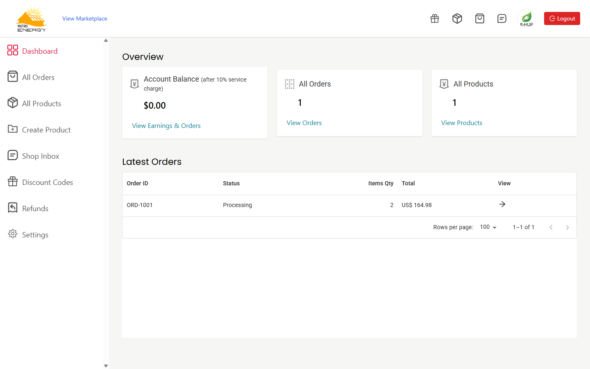

# Energy Matrix - Solar Marketplace

Energy Matrix is a full-stack multi-vendor solar e-commerce web application built with React, Redux Toolkit, Tailwind CSS, Express, and SQLite. It connects residential, commercial, and industrial buyers with verified solar vendors offering panels, inverters, batteries, accessories, and complete solar packages.

Repository: https://github.com/Areehaafareed/solar-marketplace

---

## Screenshots

### Home Page


### Products Catalog


### Solar Packages


### Product Details


### Customer Login


### Customer Profile & Orders


### Vendor Dashboard


---

## Features

### Customer Experience
- Account registration, login, and persistent JWT authentication
- Profile management (name, phone number, profile picture upload, password update)
- Saved delivery addresses management
- Live product search and category filtering across solar products and turnkey packages
- Persistent cart and wishlist synced with the backend database
- Checkout with saved addresses, coupon code validation, and multiple payment options (Card, PayPal, Cash on Delivery)
- Order history, live order tracking, refund requests, and product reviews
- Direct customer-to-vendor inbox messaging
- Quote inquiry form on the Contact Us page

### Vendor Experience
- Vendor registration with business license upload and separate vendor authentication
- Shop dashboard showing earnings overview, product count, and recent orders
- Create, preview, and delete solar products or solar packages with image uploads
- Manage customer orders and update fulfillment or refund statuses
- Create and delete discount coupon codes
- Shop inbox for answering customer inquiries
- Public shop storefront page and editable shop settings

---

## Tech Stack

- **Frontend:** React 18, React Router v6, Redux Toolkit, Tailwind CSS, Material UI DataGrid, React Toastify
- **Backend:** Node.js, Express, Multer, bcryptjs, custom HMAC-SHA256 JWT authentication
- **Database:** SQLite via Node's built-in `node:sqlite` (`DatabaseSync`), automatically initialized and seeded on first run

---

## Project Structure

```text
solar-marketplace/
|-- backend/
|   |-- auth.js          # Password hashing and JWT token helpers/middleware
|   |-- db.js            # SQLite schema initialization and initial seed data
|-- public/
|   |-- Assets/          # Marketplace images and logos
|-- screenshots/         # Application screenshots
|-- scripts/
|   |-- dev.js           # Concurrent runner for backend and React dev server
|-- src/
|   |-- components/      # Shared UI, cart, checkout, payment, profile, and shop components
|   |-- redux/           # Store, actions, and reducers
|   |-- routes/          # Route exports and protected route guards
|   |-- screens/         # Application pages and vendor dashboard screens
|   |-- styles/          # Component stylesheets and Tailwind helpers
|   |-- utils/
|       |-- api.js       # Fetch wrapper with token injection and asset URL resolution
|-- server.js            # Express API server and static uploads handler
|-- package.json
```

---

## Getting Started

### Prerequisites
- Node.js 22.5+ (tested on Node.js v24) and npm

### Installation

1. Clone the repository:
   ```bash
   git clone https://github.com/Areehaafareed/solar-marketplace.git
   cd solar-marketplace
   ```

2. Install dependencies:
   ```bash
   npm install --legacy-peer-deps
   ```

3. Start both the backend server and React frontend together:
   ```bash
   npm run dev
   ```

   You can also run them separately if preferred:
   ```bash
   npm run server   # Starts Express API on http://localhost:3001
   npm start        # Starts React app on http://localhost:3000
   ```

On the first launch, `backend/db.js` automatically creates `data/energy_matrix.db` and seeds default vendors, products, solar packages, coupons, and a demo customer account.

---

## Demo Accounts & Coupon Codes

You can sign up as a new customer or vendor, or use the pre-seeded demo credentials:

- **Customer Login**
  - Email: `alice.smith@gmail.com`
  - Password: `password123`
- **Vendor Login**
  - Email: `electronicshub@gmail.com`
  - Password: `password123`
- **Sample Coupon Codes**
  - `SOLAR10` (10% discount, minimum order $20)
  - `WELCOME20` (20% discount, minimum order $50)

---

## Main API Endpoints

- **Auth & Profile:** `POST /api/auth/signup`, `POST /api/auth/login`, `GET /api/auth/me`, `PUT /api/auth/profile`, `POST /api/auth/profile-picture`, `POST /api/auth/change-password`
- **Addresses:** `GET /api/addresses`, `POST /api/addresses`, `DELETE /api/addresses/:id`
- **Vendors:** `POST /api/vendor/register`, `POST /api/vendor/login`, `GET /api/vendor/me`, `PUT /api/vendor/profile`, `GET /api/vendors/:id`
- **Products & Reviews:** `GET /api/products`, `GET /api/products/:id`, `POST /api/products`, `DELETE /api/products/:id`, `POST /api/products/:id/reviews`
- **Cart & Wishlist:** `GET/POST/DELETE /api/cart`, `PUT /api/cart/:productId`, `GET/POST/DELETE /api/wishlist`
- **Coupons:** `GET /api/coupons/vendor`, `POST /api/coupons`, `DELETE /api/coupons/:id`, `POST /api/coupons/apply`
- **Orders:** `POST /api/orders`, `GET /api/orders/user`, `GET /api/orders/vendor`, `GET /api/orders/:id`, `PUT /api/orders/:id/status`, `POST /api/orders/:id/refund`
- **Messages & Contact:** `GET /api/messages`, `POST /api/messages`, `POST /api/contact`

---

## Production Build

```bash
npm run build
```

This outputs an optimized production bundle inside the `build/` directory.
